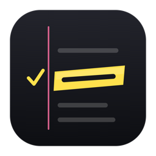

<p align="center"></p>

# Proofmark

**Highlight anything on your Mac. Proofmark tells you if it's true, and digs deeper when you want more.**

Select a sentence and press **⌥Space**. Proofmark reads the selection from whichever app has focus. A glass panel opens next to your cursor. In a few seconds the claim gets marked with a highlighter colour for its verdict, followed by the exact quotes that prove it, every source it read, and the earliest coverage it found. One click turns any claim into a full research brief.

Built for the **Nebius × NVIDIA Global AI Hackathon**, track **Best Apps and Agents**.
Powered by **NVIDIA Nemotron** on **Nebius Token Factory**, and by **Tavily** for every piece of evidence.

**[Watch the demo video](https://youtu.be/L16wNqHwLQA)** · **[Download the macOS test build](https://github.com/NoeGRANGE/fact-checker/releases/tag/v0.1.0)**

| Shortcut | What it does |
|---|---|
| **⌥Space** | Fact-check the selected text |
| **⌃⌥Space** | Research the selected text (cited brief) |
| **⌥⇧Space** | Fact-check a region of the screen (tweets as images, slides, video frames) |
| **⌘C** in the panel | Copy the verdict or brief as Markdown |
| **Esc** | Close the panel |
| Menu bar → **History…** | Every past check and research, searchable, stored only on your Mac |

---

## Quick start

You need **two API keys**: `NEBIUS_API_KEY` from [Nebius Token Factory](https://tokenfactory.nebius.com) and `TAVILY_API_KEY` from [Tavily](https://app.tavily.com). Copy `.env.example` to `.env` and paste them in. The other variables are optional, because the Nemotron models are detected automatically.

### Option A: one command (macOS with Xcode command line tools)

```bash
git clone https://github.com/NoeGRANGE/fact-checker.git && cd fact-checker
./run.sh      # first run creates .env: add your two keys, then run it again
```

`run.sh` builds `Proofmark.app`, opens it in your menu bar, and starts the backend on `http://127.0.0.1:8787`. It uses [uv](https://docs.astral.sh/uv/) if you have it, and plain `python3 -m venv` + `pip` otherwise.

### Option B: no Xcode (prebuilt app + Docker)

1. Download `Proofmark.zip` from the [latest release](https://github.com/NoeGRANGE/fact-checker/releases/latest), unzip it, then:
   ```bash
   xattr -dr com.apple.quarantine Proofmark.app   # the app is not notarized by Apple
   open Proofmark.app
   ```
2. Start the backend:
   ```bash
   cp .env.example .env    # add your two keys
   docker compose up
   ```

### Option C: no Mac (web playground)

```bash
cp .env.example .env    # add your two keys
docker compose up
```

Open **http://127.0.0.1:8787**. The playground runs the same pipeline as the Mac app: fact-check, research, sources and quotes.

### macOS permissions

- **Accessibility** (asked on first launch): needed to read the selected text in other apps. Grant it in System Settings → Privacy & Security → Accessibility, then press ⌥Space again.
- **Screen Recording** (asked on the first ⌥⇧Space): needed for screen region checks.

### Try these

- *The Great Wall of China is the only man-made structure visible from space with the naked eye.* → **False**
- *Mount Everest is 8,849 meters tall and grows about 4 millimeters each year.* → two claims, **Mostly true** + **Misleading**
- Select *Nemotron 3 Ultra* and press **⌃⌥Space** → a cited research brief

---

## How it works

### Fact-check (⌥Space)

```
 Proofmark.app (Swift)            backend (FastAPI)                          Nebius Token Factory / Tavily
 ⌥Space → selected text   ──►  1. split into claims + write queries   ──►  Nemotron 3 Nano 30B
 ⌥⇧Space → screenshot          0. image → text                        ──►  Nemotron 3.5 Super VL
        ▲                      2. search to CONFIRM and to CHALLENGE  ──►  Tavily /search  (×2, parallel)
        │ live SSE events      3. read the best sources in full       ──►  Tavily /extract
        └───────────────────   4. judge from the sources only         ──►  Nemotron 3 Ultra 550B
                               5. drop any quote not found verbatim   (plain code, no model)
                               6. find the earliest dated coverage    ──►  Tavily /search (news)
```

### Research (⌃⌥Space, or "Dig deeper" on any claim)

```
 selected text / claim    ──►  plan, search, write a cited brief      ──►  Tavily /research (streamed)
                          ──►  TL;DR + follow-up questions            ──►  Nemotron 3 Nano 30B
```

Every step streams to the panel as soon as it finishes: sources appear before the verdict, and the research brief is written live. Verdict details, each source, each quote and each report section are accordions you can fold and unfold.

---

## How we use Tavily

Tavily provides all the evidence. It is not one search pasted into a prompt, and we use three endpoints:

- **`/search`, adversarial.** For each claim, Nemotron writes one query that would *confirm* it and one that would *debunk* it. Both run in parallel with `search_depth=advanced`, `chunks_per_source`, the right `topic` (`news`, `finance`, `general`), and `time_range` when the claim is about recent events. The best challenging source is always read, so the judge never sees one side only.
- **`/extract`, as ground truth.** It pulls the full text of the top sources. The judge must quote them, and plain code then checks every quote character by character against that text. A quote that isn't really there is dropped, and the panel says so. A verdict without a verified quote is capped at 40% confidence.
- **`/search` (news) for origin tracing.** We search the exact phrase and sort by `published_date` to show where a number or quote first appeared.
- **`/research`, streamed.** "Dig deeper" runs Tavily's research agent. Its plan, its search queries, its sources and the report itself stream into the panel as they happen.
- **Visible trace.** The panel footer lists every Tavily call live, with endpoint, intent, query, result count and latency.

## How we use NVIDIA Nemotron on Nebius Token Factory

Each step gets the right size of model, as the track suggests. All calls go through one OpenAI-compatible client (`https://api.tokenfactory.nebius.com/v1/`):

| Step | Model | Measured | Why |
|---|---|---|---|
| Split claims, write confirm/debunk queries | Nemotron 3 Nano 30B | 0.8s | Runs on every check, must be instant |
| TL;DR + follow-up questions for research | Nemotron 3 Nano 30B | not measured | Short structured summary |
| Read screenshots | Nemotron 3.5 Super VL | 2.4s | Vision: transcribes claims, ignores UI chrome |
| Judge the evidence | Nemotron 3 Ultra 550B | ~2s | Strongest reasoning for the step that decides the verdict |

Model IDs are auto-detected from the Token Factory model list, or can be pinned in `.env` (`MODEL_FAST`, `MODEL_JUDGE`, `MODEL_VISION`).

### Where Token Factory sped us up

- **One client, every model size.** Moving a step from Nano to Super to Ultra was a one-line change, so we benchmarked each step during the hackathon instead of guessing.
- **Reasoning switch + JSON mode.** `chat_template_kwargs: {"enable_thinking": false}` took Nano from 4.0s to 0.8s and Super from about 3s to about 1.6s on the same prompts. With it and `response_format: json_object`, Ultra answered a short judging test in 1.2s (about 2s in the full pipeline), and JSON mode fixed the malformed output we had seen. So the deciding step could use the biggest model.
- **Vision on the same API.** The screenshot feature needed no extra provider: the same client calls Nemotron 3.5 Super VL with an image.

### Nebius services used

- **Nebius Token Factory**: every model call at runtime (inference API).
- The backend ships as a Docker image (`backend/Dockerfile`), ready for **Nebius Serverless Endpoints**.

---

## Privacy

- **History stays on your Mac** in `~/Library/Application Support/Proofmark/history.json`. Delete an entry with a right-click in the History window.
- **What leaves your Mac:** the selected text (or screenshot) goes to your local backend, which sends it to Token Factory and Tavily with your own keys.
- **The clipboard is restored** when Proofmark has to use ⌘C to read a selection.

## Project layout

```
backend/proofmark/pipeline.py   fact-check agent + research agent (Tavily + Nemotron + quote verification)
backend/proofmark/server.py     FastAPI: /check and /research stream events over SSE, serves the playground
backend/proofmark/static/       web playground
backend/Dockerfile           backend image (docker compose up)
macos/Sources/Proofmark/        menu bar app: hotkeys, selection capture, panel, history
run.sh                       build + launch everything
package.sh                   build the universal Proofmark.zip for releases
```

Run the pipeline from a terminal:

```bash
cd backend
uv run --env-file ../.env python -m proofmark.pipeline "The Great Wall of China is visible from space."
uv run python test_pipeline.py   # quote-verification self-checks
```

## License

[MIT](LICENSE)
